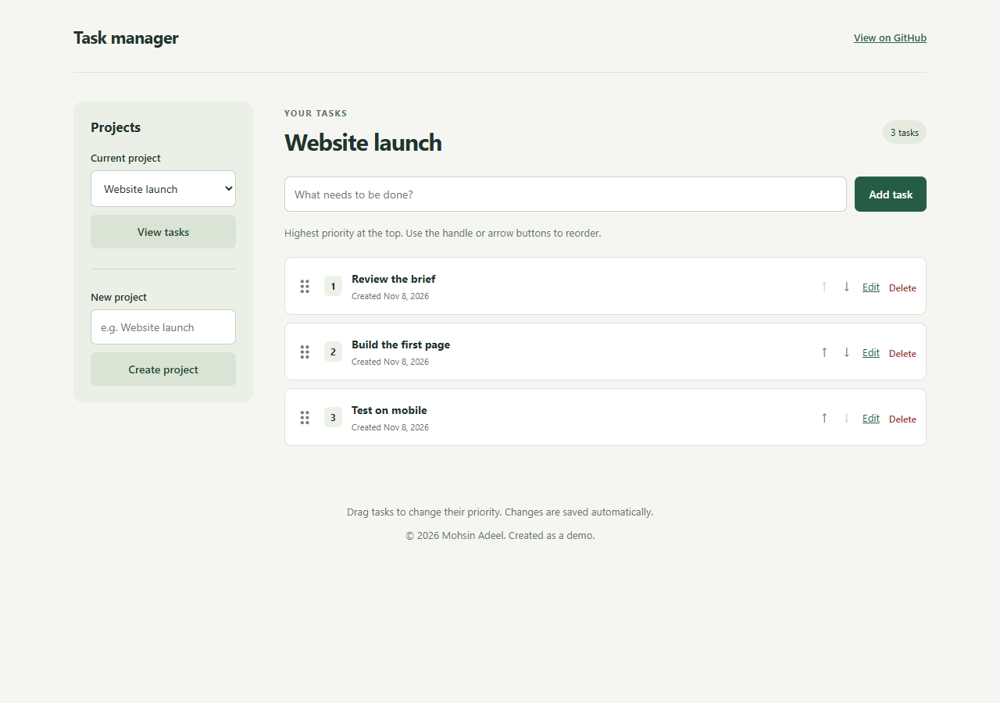

# Task manager

A small Laravel assessment application: create, edit, delete, and reorder tasks, grouped by project. Built with **Laravel 12**, **PHP 8.3**, **MySQL 8.4**, Blade, and SortableJS. Local development runs in Docker through Laravel Sail.



## Features

- Task name, integer priority, and Laravel `created_at` / `updated_at` timestamps.
- Drag a task by its handle to save a new order automatically. Arrow buttons provide a keyboard alternative.
- Priorities are consecutive **within each project**: 1 is the top task. New tasks go last; deletion closes the gap.
- Create projects and choose a project from the dropdown to view only its tasks.
- Server validation, CSRF protection, escaped Blade output, and scoped route model binding.
- Reorder failures show an error and restore the previous order. Reload before retrying so the browser gets current server state.

## Local setup (Docker + Sail)

Requirements: Git, Docker Desktop / Docker Engine with Compose. On Windows use **WSL2** for the Sail shell commands below, ideally cloning into the Linux filesystem. No host PHP, Composer, MySQL, or Node installation is needed.

```bash
git clone https://github.com/mohsinadeel/task_manager_assignment.git
cd task_manager_assignment
cp .env.example .env

# Bootstrap Composer before vendor/bin/sail exists.
docker run --rm -u "$(id -u):$(id -g)" \
  -v "$PWD:/var/www/html" -w /var/www/html \
  laravelsail/php83-composer:latest composer install --no-interaction

# Match the container user to your Linux / WSL user.
# Set WWWUSER and WWWGROUP in .env to the output of id -u and id -g.
./vendor/bin/sail up -d --build
./vendor/bin/sail artisan key:generate
./vendor/bin/sail artisan migrate
./vendor/bin/sail npm ci
./vendor/bin/sail npm run build

# Optional sample projects and tasks; safe to rerun, existing projects are skipped.
./vendor/bin/sail artisan db:seed
```

Open **http://localhost:8082**. Without seeding, create a project first. The project selector uses a normal GET form: choose a project, then click **View tasks**.

MySQL runs on the private Compose network at `mysql:3306` and persists in a named Docker volume. The default password is for local development. Change `APP_PORT` and `APP_URL` in `.env` if port 8082 is busy. The first Sail build downloads PHP packages and can take several minutes.

Useful commands:

```bash
./vendor/bin/sail artisan test
./vendor/bin/sail exec laravel.test vendor/bin/pint --test
./vendor/bin/sail artisan migrate:status
./vendor/bin/sail logs -f
./vendor/bin/sail down
```

`down` keeps database data. Avoid `down -v` unless you intend to erase it. Tests use the separate **testing** MySQL database created by Sail on first database initialization; never point tests at a database containing real data. If an old volume lacks that database, create `testing` and grant the Sail user access before running tests.

For PowerShell, use the same Compose services directly after the dependency bootstrap (replace the bind path with your project path):

```powershell
Copy-Item .env.example .env
docker run --rm -v "${PWD}:/app" -w /app laravelsail/php83-composer:latest composer install --no-interaction
docker compose up -d --build
docker compose exec laravel.test php artisan key:generate
docker compose exec laravel.test php artisan migrate --seed
docker compose exec laravel.test npm ci
docker compose exec laravel.test npm run build
docker compose exec laravel.test php artisan test
```

## How ordering works

The browser submits the complete ordered list of task IDs and the project's order version. The controller opens a transaction and locks the **project row**, which also serializes task creation and deletion for that project. It verifies that the request contains exactly that project's current tasks and the current version before assigning priorities 1 through N. Stale, missing, extra, or cross-project IDs cause a `409` with no changes; duplicate or malformed IDs cause a `422`.

A project row lock also works when the project has no tasks. All ordering mutations use that same lock. A small version counter prevents another tab from silently overwriting a more recent reorder. The `(project_id, priority)` index supports ordered project queries. There is deliberately no unique priority constraint because swapping positions updates several rows inside a transaction.

Controllers, Form Requests, Eloquent relationships, migrations, and Blade are sufficient here; no repository layer or SPA is needed. Task editing changes the name; the project is fixed by the scoped route, and priority is changed through reordering. Project rename/delete, authentication, and multi-user permissions are outside this assessment.

## Verification

Feature tests cover task CRUD, deletion compaction, project filtering and scoped routes, input validation, escaped task names, persisted reordering, stale versions, and invalid reorder payloads. Tests run against MySQL rather than substituting SQLite. GitHub Actions provides a manual-only (`workflow_dispatch`) PHP 8.3 / MySQL verification workflow for the tests, asset build and Pint formatting check. Local Sail/MySQL checks are required before pushing; pushes and pull requests do not automatically start CI.

## Integration with the Engineering Demos portal

The portal and each demo keep separate repositories and application directories. This checkout belongs at `C:\repos\demos\laravel-task-management-demo`; the parent portal excludes it from Git, Tailwind/Vite scanning and deployment archives.

Local development uses an independent Compose project and persistent MySQL volume. The portal is on port 8080, Stripe on 8081 and this app on **8082**. MySQL is not published on a host port, and this app uses built assets without a published Vite port.

Production shares one MySQL database with the portal and Stripe demo. These settings give this application its own namespace:

```dotenv
DB_CONNECTION=mysql
DB_TABLE_PREFIX=tasks_
DB_MIGRATIONS_TABLE=migrations
SESSION_DRIVER=file
SESSION_COOKIE=task_management_session
```

The physical tables are `tasks_projects`, `tasks_tasks` and `tasks_migrations`. `DB_MIGRATIONS_TABLE` is the logical name; do not set it to `tasks_migrations` or the prefix will be applied twice. Main tables remain unprefixed; Stripe tables retain their `stripe_` prefix. This demo has no authentication and does not create or modify shared users. It has its own application key and file-session directory.

Changing the prefix does not rename or import an existing standalone schema. Earlier local unprefixed records remain intact, while the prefixed schema starts empty or with optional synthetic seed data. Back up and plan an explicit data migration if those older records need importing.

For the hosted subdirectory, the intended layout is:

```text
/home6/inceptio/demo.mohsinadeel.dev/main/public/laravel-task-management-demo
    -> ../../laravel-task-management-demo/public
```

Set production `APP_URL` and `ASSET_URL` to `https://demo.mohsinadeel.dev/laravel-task-management-demo`, `SESSION_PATH=/laravel-task-management-demo`, `SESSION_SECURE_COOKIE=true`, and point `DB_HOST` / `DB_DATABASE` at the existing shared database. Keep the app's own `APP_KEY` and cookie name; do not copy the portal's key. Deploy the main app before this demo. Serve only `public/`.

Use normal `php artisan migrate --force` on the shared server. **Never run `migrate:fresh`, `db:wipe` or an automated test suite against the shared production database.** The test harness refuses to initialise unless it is running in testing mode with MySQL database `testing` and prefix `tasks_test_`, before database-refresh traits can run.

Local migration-isolation and simulated subdirectory-request tests do not prove Apache symlink behaviour on the hosted server. Hosted deployment and browser verification remain separate steps. See `evidence/LOCAL-INTEGRATION.md` for recorded evidence and limits.

## GitHub Actions

Both workflows are **manual-only** in the Actions tab:

- **Task Management checks** installs locked dependencies, builds Sail PHP 8.3 / MySQL, builds assets, checks Pint and runs PHPUnit against the disposable `testing` database.
- **Deploy Task Management demo** builds production dependencies and assets, connects through OpenVPN and SSH, uploads the application, checks the production table prefix and session configuration, runs normal migrations and creates the public-directory symlink. It does not seed automatically and keeps route caching disabled for the hosted subdirectory.

The deployment uses the repository's `production` environment. Set variables `SSH_HOST` and `DEPLOY_PATH` (exactly `/home6/inceptio/demo.mohsinadeel.dev/laravel-task-management-demo`). Configure secrets `OPENVPN_CONFIG`, `VPN_USERNAME`, `VPN_PASSWORD`, `SSH_PRIVATE_KEY`, `SSH_USERNAME`, `SSH_PORT` and `SSH_KNOWN_HOSTS`. The known-hosts value must come from an independently verified server fingerprint; the workflow enforces host-key verification. Keep the server `.env` private and provision it before the first deployment. PHP 8.4 is selected on the server to match the portal; the app's minimum remains PHP 8.3.

Workflow syntax checks do not prove VPN, SSH credentials or server routing. No deployment has been run for this integration.

## Deployment

Sail is the development environment. For a server, deploy this as a standard Laravel application using PHP **8.3+** with Composer, MySQL **8.4**, and Nginx / Apache with PHP-FPM. Install the [Laravel-required PHP extensions](https://laravel.com/docs/12.x/deployment#server-requirements), including `pdo_mysql`. Build assets in CI or on a build machine with Node 22+.

1. For the Engineering Demos host, use the existing shared MySQL database. Configure this app with its own table prefix; do not create, drop or alter portal users or Stripe tables. For a standalone installation, provision a separate MySQL database and database user. Configure the web server's document root to the application's **public/** directory, with requests forwarded to `public/index.php`.
2. Create a server-only `.env` with `APP_ENV=production`, `APP_DEBUG=false`, the real HTTPS `APP_URL`, a strong database password, and `DB_HOST` set to the actual database host. Keep `.env` outside version control. Use `SESSION_SECURE_COOKIE=true` with HTTPS.
3. Install and build:

   ```bash
   composer install --no-dev --prefer-dist --optimize-autoloader --no-interaction
   npm ci
   npm run build
   # Only on the first deployment; preserve this key for subsequent releases.
   php artisan key:generate --force
   php artisan migrate --force
   php artisan optimize
   ```

4. Give the PHP-FPM user write access to `storage/` and `bootstrap/cache/`. Serve over HTTPS. Do not use `artisan serve` as the production web server. No queue worker or scheduler is required.
5. Back up the database before later migrations. Deploy tested releases, reload PHP-FPM, and verify task creation, editing, deletion, and reorder persistence after a page refresh. Do not seed sample data in production unless intentionally demonstrating the app.

This is a shared assessment demo with **no login**: anyone who can reach it can change its tasks and projects. Put a public demo behind access control if its data needs protection. Docker hosting is also possible, but use a production PHP-FPM/web-server image rather than publishing the Sail development container.
